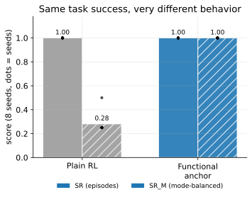
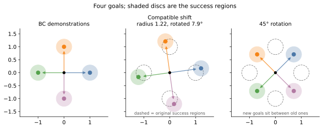
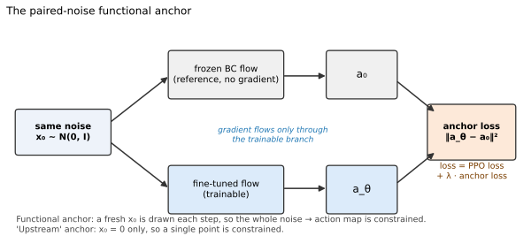
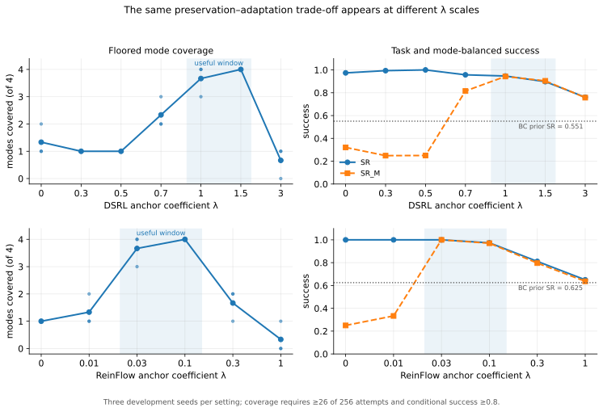
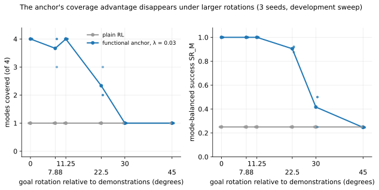

> Code and experiment artifacts: [multimodal_policy_finetuning](https://github.com/akashprakas/multimodal_policy_finetuning)

## Core problem 

Generative policies that use diffusion or flow for their action policy have the ability to represent different ways to solve a task,
thereby having inherent multimodal behavior in them. When we do only BC and measure the entropy or modes we can see that the multimodality is preserved, but unfortunately when we do RL finetuning on them this often destroys the diversity and make the 
policy converge to one goal.



This failure can be surprisingly easy to miss , in this i used a fourgoal env where the policy gets equal reward when reaching one of the four goal , what we observed was that the when doing RL fine tuning on them the unconstrained policy reached a 100% success
while sending every trajectory to one goal, so if we judge only by task reward the policy is perfect.But if we judge by the behaviors ie the different goals it reaches the policy have completely collapsed.

We looked into two ways of doing this:

- **Functional anchoring**, which discourages the fine-tuned policy from changing the pretrained noise-to-action function too much.
- **[Behavioral Mode Discovery for Fine-tuning Multimodal Generative Policies](https://behav-mod-dis.github.io/)**, an existing work from Longhini et al., which uses a mutual-information objective to make different latent skills produce distinct trajectories.

Main finding is that these mechanism solve different problem, and when combined works better than alone.

> Functional anchoring preserves useful behaviors that are already present. Mutual information helps discover or reorganize behaviors when the old ones no longer solve the task.

This distinction is important because it is directly tied to the positive results and failure cases as well.

## A small environment that exposes mode collapse

The environment starts at the origin and contains four possible goals. Demonstrations reach four equally valid modes, so a BC policy can learn a multimodal distribution over trajectories.

We then change the reward landscape during RL fine-tuning in two ways:

1. **Compatible outward shift.** The goals move farther from the origin and rotate by only 7.9 degrees. The old behavioral modes are still useful, but they must be extended and adjusted slightly. We call this the “radius-shift” setting below for brevity, but it is not a mathematically pure radius change.
2. **Rotation.** The goals rotate by 45 degrees. Each new goal lies between two old demonstration directions, so merely preserving the old modes is insufficient.

These shifts create a useful controlled comparison:

```text
Outward + 7.9° shift → preserve and adapt existing modes
45° rotation        → reorganize or discover modes
```



## Success rate is not enough

Suppose all rollouts reach one goal and ignore the other three. Overall success is still 100%, even though the policy has retained only one quarter of the intended behavior. So i reuse the same metrics used in the Behavior mode Discovery paper.

- **SR:** overall task success.
- **SR_M:** success averaged across the four modes rather than across episodes.
- **Mode coverage:** the number of modes whose conditional success is at least 80%, with a minimum-attempt requirement.
- **Successful-mode entropy:** how evenly successful trajectories are distributed among the modes.

The minimum attempt rule matters since a mode visited once with one successful episode should not count as reliably solved. 


Every final policy was evaluated for 1,024 episodes per training seed. These episodes improve the precision of evaluating one policy; the independent training seeds measure the variability of the learning algorithm.


## Functional anchoring

Let $f_0(s,\epsilon)$ be the pretrained policy's action for state $s$ and noise $\epsilon$, and let $f_\theta(s,\epsilon)$ be the fine-tuned policy. The functional anchor is

$$
\mathcal L_{\text{anchor}}
=
\mathbb E_{s,\epsilon}
\left[
\left\|f_\theta(s,\epsilon)-\operatorname{sg}\!\left(f_0(s,\epsilon)\right)\right\|^2
\right].
$$

The same noise is being passed through the current and reference (detached ) policies. The idea being the loss preserves not only the overall action distribution but also the correspondence between regions of noise space and behaviors. On a high level if one noise region originally produced an upward trajectory and other produced a leftward trajectory in the base frozen BC policy , the anchor makes it costly to remap both regions onto a  single direction during RL .




The coefficient $\lambda$ controls a familiar trade-off:

```text
weak anchor     → reward dominates; modes can collapse
moderate anchor → adaptation with behavioral preservation
strong anchor   → reference is preserved, but adaptation may be blocked
```

This is very much related to [Flow Q-Learning (FQL)](https://arxiv.org/abs/2502.02538). FQL trains a one-step actor to maximize an offline critic while matching the action produced by a pretrained flow for the same sampled noise. It also interprets this shared-noise squared error as an upper bound on the Wasserstein distance between their action distributions. The regularizer and its transport interpretation are therefore not new here.

The role of regularizer is different in this study. FQL distills a multi-step flow into a separately deployed one-step policy using offline dataset states and Q-learning. We instead use the paired loss as a behavioral trust region during online PPO fine tuning , either by steering a frozen diffusion decoder as in the case of DSRL or by updating the multi-step flow directly as in the case of reinflow. ReinFlow's paper contains a related paired-output objective; later we separately compare paired random noise with the released implementation's single input $x_0=0$.

### The anchor has a working window

So we did a 10 seeded sweep on the different lambda values for both DSRL and reinflow to see the effective region of lambda for both DSRL and Reinflow. Each policy was evaluated for 256 episodes. For a consistent comparison, we recomputed coverage from the saved attempt counts using the same floor,  a mode requires at least 26 attempts and at least 80% conditional success.



These are not universal values, the numerical value of lambda might depend on policy backend, action normalization , and the task. This to show that both under regularization and over regularization are real failure modes.


## When the old modes remain useful

### DSRL: preserving decoded behavior during noise steering

Functional anchoring was first tested with DSRL where the pretrained diffusion policy remain frozen as an action decoder , while PPO trains a steering policy that transforms its input noise. The anchor compares the action decoded from the steered noise with the reference action decoded from the corresponding unsteered noise.

The compatible outward shift is favorable to preservation , it might be because the pretrained BC trajectory distribution already point in useful direction and the new goal only needed to travel further and rotate slightly. Plain reward only DSRL adapted to new goal , but lost diversity and collapsed to one goal.


For the final DSRL radius-shift study:

| Method | SR | SR_M | Coverage | Successful-mode entropy |
|---|---:|---:|---:|---:|
| BMD | 0.993 | 0.943 | 3.80/4 | 0.911 |
| Functional anchor | 0.956 | 0.954 | **4.00/4** | **0.951** |


The average difference does not tell the whole story. BMD usually performed extremely well, but one seed dropped to two covered modes. Functional anchoring covered all four modes in every final seed. Across the two radius-shift batches, it achieved full coverage in 18/18 seeds, compared with 14/18 for BMD.


### ReinFlow: separating adaptation from diversity

Another experiment was conducted with reinflow to see the working of functional anchor with an flow based PPO fine tuning. Five different experiments were done

- freezing the policy;
- retaining stochasticity through a trainable noise head;
- unconstrained reward optimization;
- anchoring only the flow output at $x_0=0$;
- anchoring outputs over randomly sampled, shared noise.

The final results were:

| ReinFlow variant | λ | SR | SR_M | Floored coverage | Successful-mode entropy |
|---|---:|---:|---:|---:|---:|
| Frozen | — | 0.567 | 0.556 | 0/4 | 0.970 |
| Noise-only | — | 0.526 | 0.515 | 0/4 | 0.968 |
| Plain RL | — | 1.000 | 0.281 | 1.00/4 | 0.001 |
| Upstream anchor, $x_0=0$ | 0.01 | 1.000 | 0.906 | 2.25/4 | 0.571 |
| Functional paired-noise anchor | 0.03 | **1.000** | **1.000** | **4.00/4** | **0.955** |

Here fully frozen means  both the pretrained mean velocity field and its exploration noise head network are held fixed. In noise head only control, the pretrained velocity field network remain frozen, while PPO updates the smaller head that predicts the transition std_dev $\sigma(s,t)$. This can change how much noise is injected at each flow step, but not the mean direction. Final one trains both .


Each control fails in a different way:

- A fully frozen actor preserves diverse visitation but cannot adapt to the shifted task.
- Updating only the noise head changes stochasticity but still cannot move the mean behavior far enough to solve the shifted task reliably.
- Plain RL solves the task but collapses onto one mode.
- The single-point anchor helps, but constraining $x_0=0$ might not help to in understanding what the flow does over the rest of the noise space.
- The paired-noise anchor constrains the sampled noise-to-action function and preserves every mode in every seed.

The frozen control also shows that the functional result is not simply obtained by refusing to learn. The frozen policy remained diverse but under-reached the shifted goals, whereas the functionally anchored policy adapted and succeeded. So these suggest functional anchor helps in retaining the base BC policy behavioral structure and mode distributions.

## How preservation degrades with rotation

Now we moved to the rotated test case where the the goal that the BC policies are pretrained are shifted and then we do RL on that to see if the new policy can find the shifted goals. What was found was that the in case of Reinflow the multimodality preserving benefits gets lost and get collapsed to one mode when the rotation angle reach 45 degrees. 

| Goal rotation | ReinFlow functional anchor, λ=0.03 | Plain ReinFlow |
|---:|---:|---:|
| 0° | 4.00/4 | 1.00/4 |
| 7.9° | 3.67/4 | 1.00/4 |
| 11.25° | 4.00/4 | 1.00/4 |
| 22.5° | 2.33/4 | 1.00/4 |
| 30° | 1.00/4 | 1.00/4 |
| 45° | 1.00/4 | 1.00/4 |




For small rotations , anchoring allows the policy to adapt while retaining nearly all four successful modes. Its advantage then shrinks and solve only one goal for Reinflow , which is similar to what plain reinflow do. The anchor therefore does **not** preserve successful multimodality under the large rotation.


Incase of DSRL at 45 degrees, plain DSRL reaches one goal with perfect overall success, whereas DSRL with the functional anchor covers no goal reliably. In the ReinFlow plain and functionally anchored policies both reach approximately perfect overall success but cover only one goal. BMD is the only tested method here that learns multiple successful rotated modes, reaching 3.10/4 coverage under the final DSRL protocol.

| Method | SR | SR_M | Coverage | Successful-mode entropy |
|---|---:|---:|---:|---:|
| Plain DSRL | **1.000** | 0.250 | 1.00/4 | 0.000 |
| Functional anchor only | 0.321 | 0.098 | 0.00/4 | 0.051 |
| BMD | 0.971 | **0.799** | **3.10/4** | **0.762** |


This gives the main boundary of the method:

> A functional anchor can preserve and locally adapt behaviors represented by its reference, but it cannot be expected to manufacture a new behavioral decomposition.


## Potential reason why BMD discovered rotate modes

BMD samples a latent skill $z$, executes a skill-conditioned policy, and trains an inference model $q_\phi(z\mid\tau)$ to recover the skill from the resulting behavior. Its intrinsic reward contains

$$
r_{\text{MI}} = \log q_\phi(z\mid\tau)-\log p(z).
$$

If every latent produced the same trajectory, the classifier cannot infer which latent was sampled. The policy can increase its intrinsic reward by making different latent codes produce distinguishable behaviors. On the rotated task , this discovery pressure will help divide the new solution space among different skills, functional anchoring alone has no equivalent incentive, it basically encourages the policy to stay close to the reference BC behavior.

The ablations also showed that simply adding latent capacity was insufficient. The mutual-information reward was the important component, while the curriculum and policy entropy mainly assisted optimization.

### What made BMD work in practice (Implementation details that helped paper reproduction)

The first BMD implementation performed poorly even though a steering search through the noise space confirmed that the frozen decoder could reach all four goals.
The limitation was therefore not the action space reachability but the MI optimization pipeline was failing to turn that capacity into useful skills. The below
four details helped in getting better result.

1.  **The classifier needed a meaningful spatial scale.** What helped the most was that we needed to add noise to the input to the classifier and this was helping BMD the most and without it BMD barely worked, it might be because without  it could identify skills from tiny, behaviorally irrelevant differences near the origin. 
2.  **The inference model needed enough optimization.**  With one full batch update per epoch, its prediction remained close to uniform and the intrinsic reward was nearly zero. The final working config uses 32 classifier minibatch updates per epoch with a higher inference learning rate.
3. **Discovery had to precede task optimization.** Applying task reward from the beginning collapsed the latent skills before the inference model had organized them. A discovery warm up followed by task finetuning worked better.
4. **The steering distribution needed to retain variance.** Task optimization otherwise shrank its standard deviation and removed access to alternative directions. A small steering policy entropy bonus improved reliability. This bonus is an implementation addition in the reproduction, not a component specified by the BMD paper.


The broader lesson is not that these particular hyperparameters transfer unchanged. It is that high mutual information can still represent useless distinctions, and that the policy must retain enough exploration capacity for the discovered distinctions to become successful behavioral modes.


## Discovery and preservation may be complementary

Some experiments combining both BMD and functional anchor were done and results were good.On eight seeds with 256 evaluation episodes each ,seven of eight combined runs covered all four modes. One covered three.


| Method | SR | SR_M | Coverage | Successful-mode entropy |
|---|---:|---:|---:|---:|
| BMD | 0.976 | 0.797 | 3.12/4 | 0.793 |
| BMD + functional anchor | **0.999** | **0.968** | **3.88/4** | **0.910** |


The plausible division of labor is simple:

```text
Mutual information → creates pressure for distinct behaviors
Functional anchor  → limits destructive drift once those behaviors emerge
```


## Some lessons learned during experiments

1. **Reference quality matters.** Anchoring a weak BC policy preserves weak behavior. On the radius shift, improving the reference from 2,000 to 20,000 BC updates changed anchoring from failure to reliable four-mode coverage. Conversely, for BMD steering a frozen diffusion decoder, extensive BC training (e.g., 20k steps) over-specializes the decoder's on sticking to the action distribution in BC demonstration direction, causing held out diagonal coverage to fall ($3.12 \to 1.12$ modes). A less specialized decoder prior leaves more reachable latent paths for downstream skill discovery.
2. **Action entropy is not mode preservation.** Local stochasticity can remain high while all trajectories belong to the same global behavioral mode. So no matter how much entropy bonus you gave you wont get better mode coverage.
3. **Raw success can reward collapse.** The policy might achieve high success by repeatedly using one easy solution while ignoring other valid solutions. If multiple behaviors are desired, measure  we should measure success rate for each mode, number of attempts for each mode and total number of distinct modes covered.


## Preserve or discover?

The experiments suggest the following practical guide:

| Fine-tuning situation | Likely useful mechanism |
|---|---|
| Pretrained modes remain competent | Functional anchoring |
| Existing modes need a small local adjustment | Functional anchoring with a tuned coefficient |
| Modes must be substantially reorganized | BMD or another explicit discovery objective |
| Discovery is possible but unstable | BMD plus a moderate anchor, pending final confirmation |
| Reference policy lacks useful competence | Improve the reference or use discovery; anchoring alone will not help |

Functional anchoring should therefore be viewed as a **behavioral trust region**.  It can prevent reward optimization from erasing useful multimodal structure.But it could hurt discovery, when the downstream task requires genuinely different behaviors. So basically whether to use functional anchor or not can depend on 

::: {.callout-tip}
### Diagnostic Question for RL Fine-Tuning
Does the downstream task require the policy to **preserve and locally adapt** an existing behavioral decomposition, or to **discover a new one**?
:::

The answer determines whether a functional anchor is protection or a constraint in the wrong direction.

## Limitations

This is a controlled four-goal study, not yet evidence of broad robotic generalization. The environment makes behavioral modes and task shifts measurable, but real manipulation tasks have higher-dimensional observations, longer horizons, ambiguous mode definitions, and more complex dynamics.

The paired-noise loss and its Wasserstein upper-bound interpretation are also established ideas. Related precedents include Flow Q-Learning, ReinFlow, LP-DS's noise-space trust region for DSRL, and ORW-CFM-W2's Wasserstein-motivated regularization for online flow fine-tuning. The contribution of this study is the controlled comparison between preservation and MI-based discovery, its extension across DSRL and direct flow fine-tuning, and the empirical characterization of when preservation helps or obstructs adaptation.

 
## Credits and related work

This study builds directly on four projects:

- **Behavioral Mode Discovery.** Longhini, Emukpere, Renders, and Kim, *[Behavioral Mode Discovery for Fine-tuning Multimodal Generative Policies](https://behav-mod-dis.github.io/)* ([arXiv:2605.11387](https://arxiv.org/abs/2605.11387)). BMD provides the mutual-information mode-discovery objective reproduced and studied here.Also the four goal env base.
- **Flow Q-Learning.** Park, Li, and Levine, *[Flow Q-Learning](https://arxiv.org/abs/2502.02538)*. FQL is the closest precedent for the shared-noise output-matching loss and its Wasserstein upper-bound interpretation, although it uses the loss for offline one-step policy distillation rather than online mode preservation.
- **Diffusion Steering Reinforcement Learning.** Wagenmaker et al., *[Steering Your Diffusion Policy with Latent Space Reinforcement Learning](https://arxiv.org/abs/2506.15799)*. DSRL supplies the frozen diffusion decoder and latent-noise steering formulation used by the diffusion experiments.
- **ReinFlow.** Zhang et al., *[ReinFlow: Fine-tuning Flow Matching Policy with Online Reinforcement Learning](https://arxiv.org/abs/2505.22094)*. ReinFlow supplies the learnable-noise flow-chain PPO formulation used by the direct flow-policy experiments and contains a related paired-output regularizer.

The  implementations and conclusions are independent reproductions and extensions; they should not be interpreted as claims made or endorsed by the original authors.


