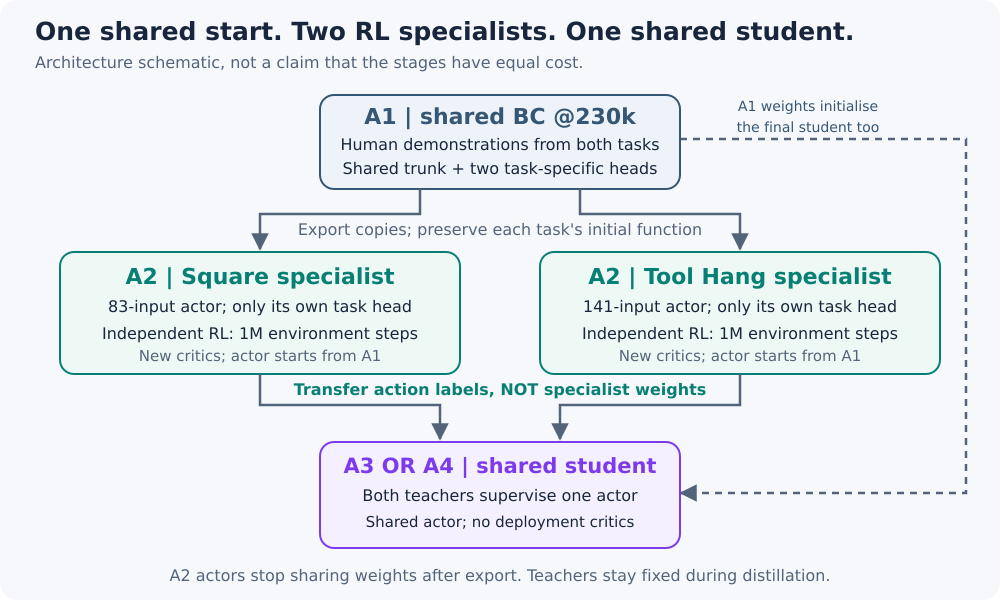

::: {.callout-note title="Code and experiment evidence"}
- **Code:** [flow_policy_distillation on GitHub](https://github.com/akashprakas/flow_policy_distillation).
- **Results:** [Saved evaluation summaries and query accounting](evaluations.json).
- **Controlled follow-up:** [Complete ten-seed analysis and provenance](v4-analysis.json).
:::

The goal was one robot policy that could perform two manipulation tasks. So why take a detour through two separate specialists?

There were two questions: could a shared imitation policy provide a useful start for two RL specialists? And how could their improved behaviour be transferred back into one network?

The second question has two plausible answers: collect demonstrations while the teachers act, or let the student act and ask the teachers what they would do at the states it visits. We tested both, comparing task success at matched teacher-query budgets and student-training updates.

I use descriptive names for the models and methods below. The experiment IDs remain in the diagrams and evidence files so readers can connect the story to the recorded runs.

| Model or method | Experiment ID |
|---|---|
| Shared behaviour-cloning (BC) generalist | A1 |
| Reinforcement-learning (RL) specialists | A2 |
| Offline distillation, producing the **offline student** | A3 |
| On-policy distillation (OPD) with DAgger-style dataset aggregation, producing the **DAgger student** | A4 |

**The original study below is a single-training-seed pilot with state observations, not a demonstration that the detour beats joint multi-task RL.** The [ten-seed controlled follow-up](#controlled-q3-follow-up) later in this post adds the schedule and BC controls; the historical pilot is kept separate.



## Could one policy get both tasks off the ground?

First, a common starting policy had to work on both selected Robomimic tasks: Square and Tool Hang.

| Task | Goal | State dimensions | Action chunk | Episode limit |
|---|---|---:|---|---:|
| Square MH | Place a square nut onto a peg | 23 | 4 consecutive 7-D actions | 400 steps |
| Tool Hang PH | Assemble a stand/frame and hang a tool | 53 | 8 consecutive 7-D actions | 1,000 steps |

MH uses multi-human demonstrations of mixed proficiency; PH uses proficient-human demonstrations. Cross-task scores are not a controlled comparison of difficulty.

We first trained the generalist with behaviour cloning (BC) on human demonstrations. Its flow-matching actor learns a velocity field that transforms Gaussian noise into an action chunk, conditioned on the current state.

Padding, a task tag and separate output heads let the tasks share a five-layer, 512-unit MLP. Its **143 inputs** are 53 observation slots, two task-tag slots, 56 noisy-chunk slots and 32 time features; the heads predict 28- or 56-dimensional velocities.

![One shared trunk, two task-specific velocity heads. This Square sample pads 23 observations to 53 and 28 noisy-chunk values to 56, uses task tag [1, 0], and runs only the 28-output Square head. Tool Hang fills both input groups without padding, uses [0, 1], and runs only its 56-output head.](shared-architecture.svg){#fig-shared-architecture fig-alt="Four input groups (53 observation slots, a two-value task tag, 56 noisy-chunk slots and 32 time features) concatenate into 143 inputs to five shared 512-unit GELU layers. Separate heads output 28-dimensional Square or 56-dimensional Tool Hang velocities; only the current task's head runs."}

Each update draws 256 examples per task, averages the two task losses, and updates the network once. Each head learns from its own task; the trunk learns from both.

The shared start did not work immediately. Under standardisation, Tool Hang failed despite falling imitation loss. Raw observations restored learning, but later measurements did not support the original numerical explanation; the mechanism remains open.

**How actions are sampled.** Both sampling modes start from Gaussian noise and take ten integration steps. **SDE** (stochastic differential equation) sampling adds noise during integration and uses **EMA** (exponential moving average) actor weights. **ODE** (ordinary differential equation) sampling adds no integration noise and uses the current, non-averaged weights. Because both the integration noise and the weights differ, an SDE-versus-ODE success gap does not isolate the effect of noise.

After shared BC training, the generalist reached **65.6% Square and 53.1% Tool Hang SDE success** at 230k updates. We had a starting point, not a finished generalist. The next step was to try RL specialisation.

## Would specialisation improve that shared start?

Rather than discard the BC generalist's learned representation, we exported task-specific copies and fine-tuned each independently with OGPO RL for **one million environment steps**, producing two RL specialists.

Export keeps the selected output head and removes inputs that are always zero. The fixed task tag can also be removed, provided its contribution is added to the first-layer bias:

```text
Before: other weighted inputs + task_weight * 1 + old_bias
After:  other weighted inputs + (old_bias + task_weight)
```

Export preserves the initial function apart from roundoff, producing 83-input Square and 141-input Tool Hang actors. Both retain the BC generalist's trunk, but **stop sharing weights during RL**.

**Export provenance.** The 83- and 141-input actors came from the original study's specialist exporter. The linked repository's [shared-evaluation helper](https://github.com/akashprakas/flow_policy_distillation/blob/main/core/models.py) retains the padded observation and task tag. It is a separate interface, not the full specialist export described above.

Each specialist gets a newly initialised ten-head critic ensemble. For labels, its EMA actor proposes eight SDE chunks. All ten target critic heads evaluate each candidate; the **minimum of two randomly sampled heads, with replacement**, determines that candidate's score. The highest-scoring candidate becomes the teacher label: 80 head-values per query, often batched.

The actor-only evaluations suggested that RL specialisation had helped:

| Reference policy | Square SDE | Tool Hang SDE |
|---|---:|---:|
| Shared BC generalist, 230k updates | 42/64 = 65.6% | 34/64 = 53.1% |
| RL specialists, critic-free | 57/64 = 89.1% | 58/64 = 90.6% |
| Long BC, fresh run to 500k updates | 19/64 = 29.7% | 58/64 = 90.6% |

Then a control complicated the story. Fresh shared BC trained to 500k also reached **90.6% on Tool Hang**, but only 29.7% on Square. The RL specialist's Tool Hang gain over the BC generalist at 230k did not establish that RL was necessary; that starting checkpoint was under-trained.

To test whether the RL specialists could help the BC generalist, we evaluated recovery from earlier snapshots of episodes the generalist later failed. Recovery at early snapshots gave provisional encouragement, not a guarantee that distillation would improve the student.

## Should the generalist watch the teachers, or learn on its own attempts?

Two RL specialists were not the final goal. We started each shared student from **the BC generalist's 230k-update checkpoint**, with the fixed specialists supplying action targets. Their weights are **not merged**.

**Offline distillation** lets the teachers drive and records their state-chunk pairs. **On-policy distillation with DAgger-style dataset aggregation**, shortened to **DAgger** below, lets the student drive, asking the matching teacher for a label at each decision-state while executing its own chunk. Collection follows the current student, while training also reuses labels from earlier student policies.

Why might that matter? A student's errors can lead to states a capable teacher rarely visits. More teacher demonstrations might not cover them; DAgger puts advice there. That motivates the experiment, but does not establish the cause of any gain.


| Collection/training choice | Offline distillation | On-policy distillation with DAgger aggregation |
|---|---|---|
| Who acts in the simulator? | Teacher | Current student's EMA actor, single-sample SDE |
| Who supplies target chunks? | Matching task's fixed specialist | Matching task's fixed specialist |
| When do labels arrive? | Full dataset before training | Roughly one quarter before each of four rounds |
| Which examples are retained? | All pairs in the chosen prefix, including failures | All labelled states, including failed or budget-cut episodes |
| Human demos mixed into distillation? | No; teacher-labelled data only | No; teacher-labelled data only |
| Student updates per run | 20,000 | Four blocks of 5,000 |

The code calls the student-driven method "routed DAgger": routing is just a task-ID lookup. The DAgger student **never executes the teacher's chunk**. Each round collects pairs, then trains on the accumulated pool; it is not one episode. Both students use supervised flow matching, not RL reward updates. Labels do not guarantee success.

To compare these choices, we counted teacher queries. **One query returns one labelled chunk at one state**, not one scalar action or one episode:

| Budget per task | Square pairs | Tool Hang pairs | Student gradient updates |
|---|---:|---:|---:|
| Q1, approximately 2k | 1,998 | 1,983 | 20,000 |
| Q2, approximately 8k | 7,998 | 7,969 | 20,000 |
| Q3, approximately 32k | 31,980 | 31,994 | 20,000 |

Q1 therefore means roughly 2k pairs **for each task**, or 4k combined, not 2k split between them.

Offline collection uses nested whole-episode prefixes; DAgger collection matches their counts, cutting the last episode if needed. **Each budget restarts from the same BC generalist checkpoint.** Both use 256 pairs per task per update and Adam at learning rate 0.0003, with fresh moments.

For readers familiar with large language models (LLMs), offline distillation resembles supervised fine-tuning (SFT) on teacher responses; DAgger resembles on-policy distillation at student-generated prefixes. States correspond to prefixes, but losses differ. [GKD](https://arxiv.org/abs/2306.13649) explicitly connects this idea to [DAgger](https://arxiv.org/abs/1011.0686).

## What happened when the student drove?

The smallest-budget Square result was not a DAgger success story: the offline student finished at **43/64**, while the DAgger student fell to **15/64**, below the BC generalist. Expert advice on student-visited states was not enough for this recipe.


With more labels, the Square ranking changed. At Q3, the DAgger student reached **56/64**, versus the offline student's **51/64**.

Tool Hang resisted a simple "offline first, DAgger later" rule: the DAgger student was ahead at Q1, behind at Q2, and ahead at Q3. At the largest budget, the student-driven recipe had higher point estimates on both tasks:

| Task, Q3 single-sample SDE | Offline student | DAgger student | Observed DAgger minus offline |
|---|---:|---:|---:|
| Square | 51/64 = 79.7% | 56/64 = 87.5% | +7.8 percentage points |
| Tool Hang | 43/64 = 67.2% | 49/64 = 76.6% | +9.4 percentage points |

Did that complete the round trip? On Square, the DAgger student was one episode below the critic-free RL specialist's 57/64, but below the critic-guided teacher's **62/64**. On Tool Hang, the DAgger student remained below both the RL specialist and long BC at 58/64.

The shared student makes **zero critic calls at deployment**. That is a structural saving, not a measured latency speedup or evidence of teacher equivalence.

Both Q3 comparisons have overlapping marginal intervals. Overlap is not a test of the difference; the copied summaries lack per-episode outcomes for a paired test. The 64 evaluation seeds are not independent training runs, so retraining variability remains unknown. Equal queries also do not mean equal wall-clock cost.

## Was this a benefit of student-state coverage, or something else?

DAgger may have learned to recover where the student wandered. But another difference complicates that explanation: **when data arrives and how often it is reused**.


*Schematic, not a robot rollout. Exact counts come from the saved Q1 DAgger run. [Static alternative](dagger-rounds.svg).*

The offline student has its entire dataset before the first update. The DAgger student receives roughly one quarter before each 5,000-update block. At Q1, that means training first on just 499 Square pairs:

```text
5,000 updates * 256 samples / 499 pairs = about 2,565 draws per pair
```

Those early pairs remain available in later rounds. A first-round Square pair gets about **5,343 expected draws** over the run; one arriving in the last round gets about **641**. Adam and EMA state also carry forward.

Overfitting is plausible, not established. A schedule-matched offline control would release the teacher-collected data in four stages too. Without it, "DAgger fixed covariate shift" is too strong: state source and data-arrival schedule changed together.

## What did the detour actually teach us?

On Square, the largest-budget DAgger student's SDE success count was close to the critic-free RL specialist's count in this run. Tool Hang told a more cautious story: strong BC alone and incomplete consolidation.

There is also an extra-training question. The fresh 500k BC run is not a matched continuation control for the distillation students. Continuing the same 230k checkpoint for another 20k updates on human demonstrations, using the same device and optimiser recipe, would help isolate the benefit of teacher supervision. No such same-device control is included in the supplied GPU evaluation bundle.

The pilot's result is not "always let the student drive." It motivated testing state source and data exposure together. The controlled follow-up below now adds multiple student/collection seeds, schedule-matched offline controls and same-device continuation-BC controls.

## Controlled Q3 follow-up: ten seeds and a matched schedule {#controlled-q3-follow-up}

**Update, 20 November 2026.** We completed ten replications, seeds 101–110, using the same fixed BC start and specialist bank. This is replication of student training and collection, **not ten independently trained RL teacher banks**.

Each replication trained four shared students for 20k updates: short continuation BC on the original human demonstrations, upfront offline, staged offline and DAgger. Both offline methods used the same last-whole-episode teacher prefix at or below 32k labels per task; DAgger matched its exact count. Staged offline revealed labels in four pools to match DAgger's training schedule. All arms restored the same current/EMA BC weights and started fresh Adam once.

A fifth arm continued BC for 270k additional updates. Before held-out evaluation, it selected one joint policy from +20k/+70k/+170k/+270k using the equal-weight two-task SDE average on monitor seeds 10000–10063; the earliest candidate won ties. The fixed +270k endpoint was also retained. This is not a task-wise oracle or a search over arbitrary endpoints.

All fifty training runs and their audits finished before held-out evaluation on reset seeds 200000–200127: 128 episodes per task and sampling mode. [The full analysis](v4-analysis.json) records the frozen protocol, execution provenance, individual cells and all ten paired differences.

### What changed with the controls?

Mean held-out **SDE success across ten trained shared policies**:

| Method | Square | Tool Hang | Equal-weight two-task average |
|---|---:|---:|---:|
| Short continuation BC (+20k) | 57.42% | 45.94% | 51.68% |
| Upfront offline (+20k) | 78.44% | 65.39% | 71.91% |
| Staged offline (+20k) | 75.78% | 61.72% | 68.75% |
| DAgger (+20k) | 76.48% | 69.06% | 72.77% |
| Monitor-selected long BC | 40.86% | 82.11% | 61.48% |
| Fixed long BC (+270k) | 40.55% | 86.09% | 63.32% |

The prespecified primary contrast was **DAgger minus staged offline**, averaging the two tasks within each replication first. Its mean was **+4.02 percentage points**, paired Student-t 95% interval **[+1.71, +6.34]**, sample SD **3.24 points**, with **n=10 and df=9**.

For seeds 101–110 respectively, all ten paired differences were **+8.98, −1.17, +3.52, +7.42, +5.86, +7.03, +2.34, +3.13, +2.73 and +0.39 points**. The interval is over these replication differences, not pooled episode counts.

This supports a positive average adaptive-recipe effect over schedule-matched offline, **conditional on this BC start, fixed specialists, two tasks and evaluation bank**. The task breakdown matters:

- **Square:** +0.70 points, interval [−1.75, +3.15]—inconclusive, not equivalence.
- **Tool Hang:** +7.34 points, interval [+3.89, +10.80].

It does **not** reproduce the pilot's +8.6-point gap against *upfront* offline. The follow-up's exploratory DAgger-minus-upfront average was only **+0.86 points [−1.65, +3.36]**. Staged offline was **3.16 points below upfront offline** on average, also exploratory. Thus matching the schedule changes the comparator; these results do not establish universal superiority of student-driven acquisition or isolate recovery-state coverage as the mechanism.

The key secondary contrast, DAgger minus monitor-selected long BC, was **+11.29 points [+8.73, +13.85]** on the two-task average. That interval is **exploratory and unadjusted for multiple comparisons**. It masks a large trade-off: Square favoured DAgger by **35.63 points**, but Tool Hang favoured long BC by **13.05 points** (DAgger-minus-BC interval [−20.62, −5.47]).

So sufficiently trained BC remains a strong Tool Hang alternative. The secondary result is improvement beyond these jointly selected BC candidates on average, **not proof that RL is necessary**. Square's long-BC deterioration is consistent with overfitting or task interference, but this study did not separate those mechanisms.

### The simulator boundary is part of the protocol

An earlier v3 run exposed a hidden MuJoCo numerical reset followed by observations retaining the old episode identity. We preserved that evidence and restarted the **entire** cohort as v4 before viewing held-out results; no v3 models or data enter these estimates.

V4 explicitly ends a numerical-fault episode as unsuccessful and truncated. It applies the same boundary to teachers, students, BC controls, monitoring and final evaluation, without changing physics or the optimisation recipe. Valid labels computed before the fault remain; post-reset observations cannot continue under the old identity.

Recorded faults were uncommon in this study: **teacher collection 1/14,395 episodes; DAgger student collection 0/8,780; monitoring 3/44,800**—one each in DAgger, short BC and long BC, with none in either offline arm. The two BC events replayed the same +20k policy/seed failure, not two independent discoveries. Held-out evaluation recorded **0/30,976 actually executed episodes**. These counts are conditional observations, not a general simulator reliability guarantee.

### Why a critic-selected label can jump

Best-of-8 selects a chunk; it does not average the eight chunks. Even with smooth candidate generators and critics at fixed sampling noise, **argmax selection can be discontinuous when candidate scores cross**. A small scoring change can therefore produce a large action-target change.

The audit caught this at seed 109's Tool Hang row 32002. The saved and differing replay chunks were exact candidates 1 and 0, about **0.172** apart in maximum coordinate difference. One diagnostic gave their scores as −52.8520 and −52.8499: a gap of **0.0022**. The first two probes varied by about **0.0052** in another candidate's score; a further diagnostic exposed variation up to **0.0169** and reversed the leading pair's ranking. This is consistent with a precision-sensitive Best-of-8 winner flip. The diagnostics return extra intermediates and change the compiled graph, so they do not recover the exact original sampler's hidden arithmetic.

The row was outside the actual **31,968-pair training prefix**. We preserved the failed audit and matching probes rather than retrying until green. Before seed 110 and all held-out results, we disclosed a fixed audit rule: both differing chunks must exactly match generated candidates and each must be within **0.020 Q units** of the diagnostic winner; otherwise the audit fails. That screen is not a universal floating-point error bound. No seed, dataset, checkpoint, numerical setting or analysis rule changed. Seed 110 needed no near-tie exception.

This discontinuity is relevant to learning chunk targets, but we did not measure how much it contributes to distillation difficulty. It is a mechanism to keep in mind, not an explanation retrofitted to the success gap.

### Cost and limits

The final matrix contains **32,000 logical episode records**. Selected and fixed long BC were byte-identical for seeds 108 and 110, so their matching evaluations reused results: **30,976 episodes were actually executed**. Those duplicated cells are not extra independent evidence.

V4 jobs took **34.68 hours**; cumulative job-wall cost was **40.21 hours**, including **5.53 hours** of preserved v3 work. The six-hour reserve was an allowance, not measured work. Calibration and post-job audits are separate.

The follow-up makes the comparison stronger, not universal: one fixed BC start, one fixed teacher bank, two low-dimensional tasks and ten paired student/collection replications. The t interval assumes approximately normal independent replication differences; secondary contrasts remain exploratory. The student still removes critic calls at deployment, but neither teacher equivalence nor a measured latency speedup follows.

## Credits and related work

This study builds on existing methods and open-source tools:

- **RLDG — Charles Xu, Qiyang Li, Jianlan Luo and Sergey Levine (2024).** [*RLDG: Robotic Generalist Policy Distillation via Reinforcement Learning*](https://arxiv.org/abs/2412.09858) studies using task-specific RL to generate training data for generalist policies, providing closely related work for the specialist-to-generalist pipeline.
- **Multi-teacher flow-policy OPD — Lichao Ni, Yuhan Liu, Pengfei Li and Guanghuan Fang (2026).** [*Multi-Teacher On-Policy Distillation for Flow-Based Vision-Language-Action Models*](https://arxiv.org/abs/2610.21522) is the closest related comparison identified in the [P2 protocol](p2-protocol.txt). Its proposed method also supervises teacher velocities along student-generated action flows. This pilot instead uses low-dimensional observations and critic-selected action-chunk labels, followed by supervised flow matching.
- **OGPO — Sarvesh Patil et al. (2026).** [*OGPO: Sample Efficient Full-Finetuning of Generative Control Policies*](https://arxiv.org/abs/2605.03065) provides the RL fine-tuning method and base implementation used for the specialists. See the [original implementation](https://github.com/simchowitzlabpublic/OGPO_public) and the [fork used in this study](https://github.com/akashprakas/OGPO_public).
- **DAgger — Stephane Ross, Geoffrey J. Gordon and J. Andrew Bagnell (2011).** [*A Reduction of Imitation Learning and Structured Prediction to No-Regret Online Learning*](https://arxiv.org/abs/1011.0686) introduces the learner-driven expert-labelling and dataset-aggregation approach used in the student-driven distillation recipe.
- **GKD — Rishabh Agarwal et al. (ICLR 2024).** [*On-Policy Distillation of Language Models: Learning from Self-Generated Mistakes*](https://arxiv.org/abs/2306.13649) provides the language-model connection discussed above. This study uses supervised flow-matching targets, not GKD's language-model loss.
- **Robomimic and Robosuite — the ARISE Initiative teams.** [Robomimic](https://robomimic.github.io/) provides the human-demonstration datasets and learning framework; [Robosuite](https://robosuite.ai/) provides the simulated manipulation environments used for Square and Tool Hang.

The pilot and conditional ten-seed follow-up reported here are my own low-dimensional experiments built on these methods and tools, not a new RL or distillation algorithm.