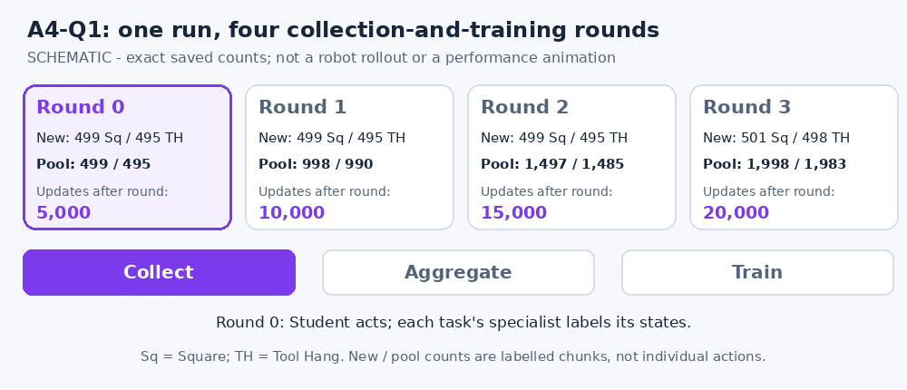
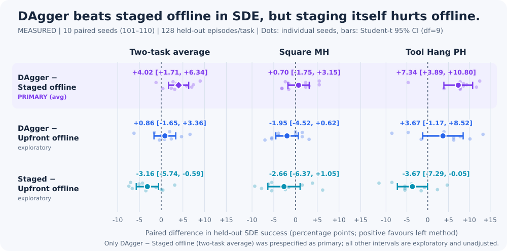
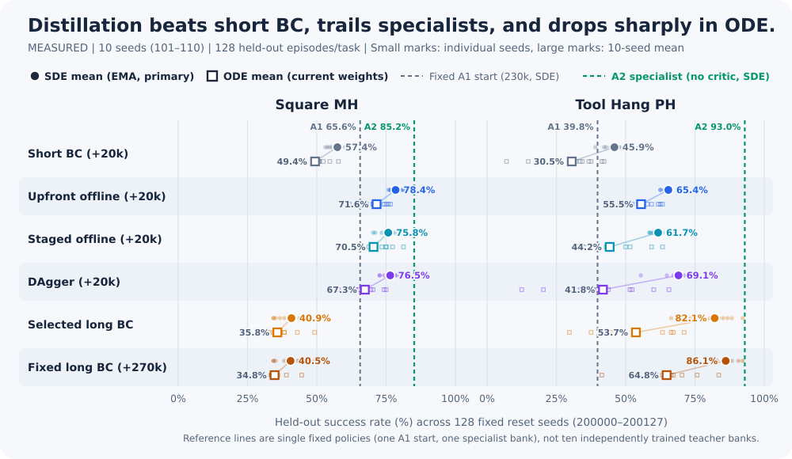

The goal was one robot policy that could perform two manipulation tasks. So why take a detour through two separate specialists?

There were two questions: could a shared imitation policy provide a useful start for two RL specialists? And how could their improved behaviour be transferred back into one network?

The second question has two plausible answers: collect demonstrations while the teachers act (**offline distillation**), or let the student act and ask the teachers what they would do at the states it visits (**on-policy distillation with DAgger-style aggregation**). We tested both at matched teacher-query budgets and student-training updates—first in a single-seed pilot across three budgets, then in a controlled ten-seed follow-up at the largest budget.


::: {.callout-important title="Key findings at a glance (ten-seed controlled follow-up, Q3 v4)"}
- **Student-driven data beats schedule-matched offline in SDE:** in the prespecified SDE mode, DAgger beat four-stage offline distillation by **+4.02 percentage points** (paired Student-t 95% CI **[+1.71, +6.34]** across ten seeds), driven mostly by Tool Hang (**+7.34 pp**; Square **+0.70 pp**, inconclusive).
- **Staging itself hurts offline distillation:** releasing teacher data in four stages cost **−3.16 pp** relative to upfront offline. Against *upfront* offline, DAgger was **+0.86 pp [−1.65, +3.36]** (inconclusive), not reproducing the single-seed pilot's +8.6 pp gap.
- **Distillation beats equal-update BC, but long BC splits by task:** all distilled students beat equal-update (+20k) continuation BC by **17–21 pp** on the two-task average. Longer BC (+270k) stayed stronger than DAgger on Tool Hang (**82–86%** vs **69.1%**) while deteriorating on Square (**41%** vs **76.5%**).
- **The round trip is incomplete and mode-sensitive:** DAgger still trails the fixed critic-free RL specialists by **8.7 pp** on Square and **23.9 pp** on Tool Hang, and its Tool Hang advantage disappears in deterministic ODE evaluation (**41.8%** vs **69.1%** SDE).
:::

::: {.callout-note title="Code, evidence files, and experiment IDs" collapse="true"}
- **Code:** [flow_policy_distillation on GitHub](https://github.com/akashprakas/flow_policy_distillation)
- **Pilot summaries:** [Saved single-seed evaluations and query accounting](evaluations.json)
- **Controlled follow-up:** [Complete ten-seed analysis and provenance](v4-analysis.json)

Descriptive names are used throughout the text; the diagrams and evidence files use these experiment IDs:

| Model or method | Experiment ID |
|---|---|
| Shared behaviour-cloning (BC) generalist | A1 |
| Reinforcement-learning (RL) specialists | A2 |
| Offline distillation, producing the **offline student** | A3 |
| On-policy distillation (OPD) with DAgger-style dataset aggregation, producing the **DAgger student** | A4 |
:::

## Setup: tasks, shared policy, and RL specialists

### Two Robomimic tasks in one shared trunk

First, a common starting policy had to work on both selected Robomimic tasks: Square and Tool Hang.

| Task | Goal | State dimensions | Action chunk | Episode limit |
|---|---|---:|---|---:|
| Square MH | Place a square nut onto a peg | 23 | 4 consecutive 7-D actions | 400 steps |
| Tool Hang PH | Assemble a stand/frame and hang a tool | 53 | 8 consecutive 7-D actions | 1,000 steps |

MH uses multi-human demonstrations of mixed proficiency; PH uses proficient-human demonstrations. Cross-task scores are not a controlled comparison of difficulty.

We first trained the generalist with behaviour cloning (BC) on human demonstrations. Its flow-matching actor learns a velocity field that transforms Gaussian noise into an action chunk, conditioned on the current state.

Padding, a task tag and separate output heads let the tasks share a five-layer, 512-unit MLP. Its **143 inputs** are 53 observation slots, two task-tag slots, 56 noisy-chunk slots and 32 time features; the heads predict 28- or 56-dimensional velocities.

![One shared trunk, two task-specific velocity heads. This Square sample pads 23 observations to 53 and 28 noisy-chunk values to 56, uses task tag [1, 0], and runs only the 28-output Square head. Tool Hang fills both input groups without padding, uses [0, 1], and runs only its 56-output head.](shared-architecture.svg){#fig-shared-architecture fig-alt="Four input groups (53 observation slots, a two-value task tag, 56 noisy-chunk slots and 32 time features) concatenate into 143 inputs to five shared 512-unit GELU layers. Separate heads output 28-dimensional Square or 56-dimensional Tool Hang velocities; only the current task's head runs."}

Each update draws 256 examples per task, averages the two task losses, and updates the network once. Each head learns from its own task; the trunk learns from both.

**How actions are sampled (SDE vs. ODE).** Both sampling modes start from Gaussian noise and take ten integration steps. **SDE** (stochastic differential equation) sampling adds noise during integration and uses **EMA** (exponential moving average) actor weights. **ODE** (ordinary differential equation) sampling adds no integration noise and uses the current, non-averaged weights; its intermediate-action clipping convention also differs. Because multiple factors differ at once, an SDE-versus-ODE gap does not isolate the effect of integration noise alone.

::: {.callout-note title="Observation standardisation pitfall" collapse="true"}
The shared start did not work immediately. Under per-dimension standardisation, Tool Hang stayed at 0/64 across all evaluations despite falling imitation loss. Switching to raw observations restored learning, though later measurements did not reproduce the original numerical explanation; the exact mechanism remains open.
:::

After shared BC training, the generalist reached **65.6% Square and 53.1% Tool Hang SDE success** at 230k updates—a working starting point, not a finished generalist.

### Exporting and specialising with RL

Rather than discard the BC generalist's learned representation, we exported task-specific copies and fine-tuned each independently with OGPO RL for **one million environment steps**, producing two RL specialists. Export keeps the selected output head, drops always-zero padded inputs, and folds the fixed task tag into the first-layer bias—preserving the initial function apart from roundoff while stopping weight sharing during RL.

::: {.callout-note title="Specialist export mechanics and code provenance" collapse="true"}
Folding the fixed task tag into the first-layer bias produces 83-input Square and 141-input Tool Hang actors:

```text
Before: other weighted inputs + task_weight * 1 + old_bias
After:  other weighted inputs + (old_bias + task_weight)
```

The 83- and 141-input actors came from the original study's specialist exporter. The linked repository's [shared-evaluation helper](https://github.com/akashprakas/flow_policy_distillation/blob/main/core/models.py) retains the padded observation and task tag; it is a separate interface, not the full specialist export described above.
:::

Each specialist gets a newly initialised ten-head critic ensemble. When generating distillation labels, its EMA actor proposes eight SDE chunks. All ten target critic heads evaluate each candidate; the **minimum of two randomly sampled heads, with replacement**, determines that candidate's score. The highest-scoring candidate becomes the teacher label (**Best-of-8**): 80 head-values per query, often batched.

Actor-only evaluations on the pilot's 64-seed bank suggested RL specialisation helped, though a long-BC control immediately complicated the picture:

| Reference policy (pilot 64-seed bank) | Square SDE | Tool Hang SDE |
|---|---:|---:|
| Shared BC generalist, 230k updates | 42/64 = 65.6% | 34/64 = 53.1% |
| RL specialists, critic-free | 57/64 = 89.1% | 58/64 = 90.6% |
| Long BC, fresh run to 500k updates | 19/64 = 29.7% | 58/64 = 90.6% |

Fresh shared BC trained to 500k also reached **90.6% on Tool Hang**, while dropping to **29.7% on Square**. The RL specialist's Tool Hang gain over the 230k generalist therefore did not establish that RL was necessary—that starting checkpoint was simply under-trained on Tool Hang. Evaluating specialist recovery from earlier snapshots of episodes the generalist later failed gave provisional encouragement, but not a guarantee that distillation would close the gap.

## Two distillation recipes: offline vs. routed DAgger

Two RL specialists were not the final goal. To consolidate them back into one network, we started each shared student from **the BC generalist's 230k-update checkpoint**, with the fixed specialists supplying action targets. Their weights are **not merged**.

- **Offline distillation** lets the teachers drive and records their state–chunk pairs before student training begins.
- **On-policy distillation with DAgger-style dataset aggregation** (shortened to **DAgger** below) lets the student drive, asking the matching teacher for a label at each decision-state while executing its own chunk. Collection follows the current student, while training reuses labels accumulated from earlier rounds too.

Why might that matter? A student's errors can lead to states a capable teacher rarely visits. More teacher demonstrations might not cover them; DAgger puts advice there. That motivates the experiment, though it does not by itself establish the cause of any gain.


| Collection / training choice | Offline distillation | On-policy distillation with DAgger aggregation |
|---|---|---|
| Who acts in the simulator? | Teacher | Current student's EMA actor, single-sample SDE |
| Who supplies target chunks? | Matching task's fixed specialist (Best-of-8) | Matching task's fixed specialist (Best-of-8) |
| When do labels arrive? | Full dataset before training | Roughly one quarter before each of four rounds |
| Which examples are retained? | All pairs in the chosen prefix, including failures | All labelled states, including failed or budget-cut episodes |
| Human demos mixed into distillation? | No; teacher-labelled data only | No; teacher-labelled data only |
| Student updates per run | 20,000 | Four blocks of 5,000 |

The code calls the student-driven method "routed DAgger": routing is just a task-ID lookup. The DAgger student **never executes the teacher's chunk**. Each round collects pairs, then trains on the accumulated pool; it is not one episode. Both students use supervised flow matching (256 pairs per task per update, Adam at lr `0.0003` with fresh moments), not RL reward updates.

To compare these choices fairly, we matched teacher queries. **One query returns one labelled chunk at one state**, not one scalar action or one episode:

| Budget per task | Square pairs | Tool Hang pairs | Student gradient updates |
|---|---:|---:|---:|
| Q1, approximately 2k | 1,998 | 1,983 | 20,000 |
| Q2, approximately 8k | 7,998 | 7,969 | 20,000 |
| Q3, approximately 32k | 31,980 | 31,994 | 20,000 |

Q1 therefore means roughly 2k pairs **for each task** (~4k combined). Offline collection uses nested whole-episode prefixes; DAgger matches their counts, cutting the last episode if needed. **Each budget restarts from the same 230k BC generalist checkpoint.**

For readers familiar with large language models (LLMs), offline distillation resembles supervised fine-tuning (SFT) on teacher responses; DAgger resembles on-policy distillation at student-generated prefixes. States correspond to prefixes, though losses differ. [GKD](https://arxiv.org/abs/2306.13649) explicitly connects this idea to [DAgger](https://arxiv.org/abs/1011.0686).

## Part 1 — The single-seed pilot and the schedule confound

*Note: this pilot uses a single training seed and 64 evaluation seeds per task. It motivated the ten-seed controlled study in [Part 2](#controlled-q3-follow-up) rather than settling the comparison.*

At the smallest budget (Q1), letting the student drive backfired on Square: the offline student finished at **43/64**, while the DAgger student fell to **15/64**, well below the 230k BC start. With more labels, the Square ranking flipped, and at Q3 the student-driven recipe had higher point estimates on both tasks—though Tool Hang resisted a simple "offline first, DAgger later" rule (DAgger led at Q1, trailed at Q2, and led at Q3).


| Task, pilot Q3 single-sample SDE | Offline student | DAgger student | Observed DAgger minus offline |
|---|---:|---:|---:|
| Square | 51/64 = 79.7% | 56/64 = 87.5% | +7.8 percentage points |
| Tool Hang | 43/64 = 67.2% | 49/64 = 76.6% | +9.4 percentage points |

At Q3, the DAgger student came within one episode of the critic-free Square specialist (**57/64**; critic-guided teacher **62/64**), while remaining below both the RL specialist and long BC (**58/64**) on Tool Hang.

### Why the pilot was not enough

Three issues stopped us from reading the pilot's +8.6 pp average Q3 gap as proof that student-state coverage wins:

1. **Data-arrival schedule confound.** Offline distillation sees its full dataset before update 1. DAgger receives roughly one quarter before each 5,000-update block, while Adam and EMA state carry forward. At Q1, round 0 trains for 5,000 updates on just 499 Square pairs (`5,000 × 256 / 499 ≈ 2,565` draws per pair); over the full run, a round-0 pair gets ~**5,343** expected draws versus ~**641** for a round-3 pair. Without a **schedule-matched (staged) offline control**, state source and data-arrival schedule changed together.
2. **Missing matched BC controls.** The fresh 500k BC run was not a matched continuation from the 230k checkpoint on the same device and optimiser recipe.
3. **Single training seed and marginal intervals.** The 64 evaluation seeds do not measure retraining variability, and the pilot's saved summaries lacked per-episode outcomes for paired tests.



*Schematic, not a robot rollout. Exact counts come from the saved Q1 DAgger run. [Static alternative](dagger-rounds.svg).*

## Part 2 — Controlled Q3 follow-up: ten seeds and a matched schedule {#controlled-q3-follow-up}

**Update, 20 November 2026.** To separate state source, staging schedule, and extra BC training, we ran ten paired replications (**seeds 101–110**) at the Q3 budget using the same fixed 230k BC start and specialist bank. This replicates student training and data collection, **not ten independently trained RL teacher banks**.

Each replication trained five shared students from the identical restored current/EMA BC weights with fresh Adam:

- **Short continuation BC (+20k):** 20k updates on the original human demonstrations.
- **Upfront offline (+20k):** full last-whole-episode teacher prefix (≤32k pairs/task) available from step 0.
- **Staged offline (+20k):** the same teacher prefix revealed in four pools matching DAgger's 4 × 5k schedule.
- **DAgger (+20k):** student-driven collection across four rounds matching that replication's exact prefix counts.
- **Long BC (+270k):** continued BC on human demonstrations, evaluating both the fixed +270k endpoint and a **monitor-selected** joint policy chosen from `+20k/+70k/+170k/+270k` via equal-weight two-task SDE average on monitor seeds `10000–10063` (earliest wins ties).

All fifty training runs and their audits finished before any held-out evaluation on reset seeds **200000–200127** (128 episodes per task and sampling mode). [The full analysis](v4-analysis.json) records the frozen protocol, provenance, individual cells, and all paired differences.

### Primary SDE result: DAgger beats staged offline, not upfront offline

The prespecified primary contrast was **DAgger minus staged offline** in SDE mode, averaging Square and Tool Hang equally within each replication first. Across the ten seeds (**n=10, df=9**):

- **Primary (two-task average):** **+4.02 percentage points**, paired Student-t 95% CI **[+1.71, +6.34]**, sample SD **3.24 pp**.
  - **Square:** **+0.70 pp [−1.75, +3.15]** (inconclusive, not equivalence).
  - **Tool Hang:** **+7.34 pp [+3.89, +10.80]**.
- **Staging penalty (exploratory, staged minus upfront offline):** **−3.16 pp [−5.74, −0.59]** on the two-task average (Square −2.66 pp, Tool Hang −3.67 pp).
- **DAgger minus upfront offline (exploratory):** **+0.86 pp [−1.65, +3.36]** on the two-task average (inconclusive).



Matching the schedule therefore changed the comparator. Conditional on this BC start, fixed specialists, two tasks, and evaluation bank, the primary result supports a positive average effect of the adaptive DAgger recipe over schedule-matched offline—mostly on Tool Hang. However, because staging itself hurt offline distillation by 3.2 pp, the ten-seed study does **not** reproduce the pilot's +8.6 pp gap over *upfront* offline, nor does it establish universal superiority of student-driven acquisition or isolate recovery-state coverage as the mechanism.

::: {.callout-note title="All ten paired primary differences (seeds 101–110)" collapse="true"}
For seeds 101–110 respectively, the two-task SDE differences (**DAgger minus staged offline**, in percentage points) were:

| Seed | 101 | 102 | 103 | 104 | 105 | 106 | 107 | 108 | 109 | 110 |
|---|---:|---:|---:|---:|---:|---:|---:|---:|---:|---:|
| Δ (pp) | +8.98 | −1.17 | +3.52 | +7.42 | +5.86 | +7.03 | +2.34 | +3.13 | +2.73 | +0.39 |

The Student-t 95% interval is computed over these ten replication differences, not pooled episode counts.
:::

### All six methods and the long-BC trade-off

Mean held-out **SDE success across ten trained shared policies** (128 episodes per task):

| Method | Square | Tool Hang | Equal-weight two-task average |
|---|---:|---:|---:|
| Short continuation BC (+20k) | 57.42% | 45.94% | 51.68% |
| Upfront offline (+20k) | 78.44% | 65.39% | 71.91% |
| Staged offline (+20k) | 75.78% | 61.72% | 68.75% |
| DAgger (+20k) | 76.48% | 69.06% | 72.77% |
| Monitor-selected long BC | 40.86% | 82.11% | 61.48% |
| Fixed long BC (+270k) | 40.55% | 86.09% | 63.32% |



Two controls stand out:

- **Teacher supervision vs. equal-update BC:** all three distillation arms beat equal-update (+20k) continuation BC by **17–21 pp** on the two-task average. Short BC's Square mean (**57.4%**) is below the fixed A1 start (**65.6%**) on these held-out seeds; continuation combines extra human-demo updates with a fresh Adam restart, and this study does not isolate the cost of restarting the optimiser. Every +20k arm shared that same restart.
- **The long-BC task trade-off (key secondary contrast, exploratory/unadjusted):** DAgger beat monitor-selected long BC by **+11.29 pp [+8.73, +13.85]** on the two-task average, but that average hides opposite task effects: **Square favoured DAgger by +35.63 pp [+31.63, +39.62]**, whereas **Tool Hang favoured long BC by 13.05 pp** (DAgger minus long BC: **−13.05 pp [−20.62, −5.47]**). Sufficiently trained BC therefore remains a strong Tool Hang alternative; this result is an average gain over jointly selected BC candidates, **not proof that RL is necessary**. Square's long-BC deterioration is consistent with overfitting or task interference, which this study did not separate.

### How much of the round trip was completed?

| Held-out SDE reference (seeds 200000–200127) | Square | Tool Hang |
|---|---:|---:|
| Fixed A1 start (230k) | 84/128 = 65.6% | 51/128 = 39.8% |
| Fixed specialists, no critic | 109/128 = 85.2% | 119/128 = 93.0% |
| Fixed specialists, Best-of-8 | 116/128 = 90.6% | 114/128 = 89.1% |
| DAgger, mean over ten student/collection seeds | 76.5% | 69.1% |

Consolidation remains incomplete: DAgger trails the critic-free specialists by **8.7 pp on Square and 23.9 pp on Tool Hang**. On Tool Hang, Best-of-8 scored below plain SDE (**89.1% vs. 93.0%**) in this single fixed-teacher evaluation; critic-guided selection is not guaranteed to improve success. Because these references use held-out seeds `200000–200127` and the v4 failure boundary rather than the pilot's 64-seed bank, percentage differences from the pilot do not reflect additional teacher training.

### Secondary ODE outcome: the Tool Hang advantage disappears

Mean held-out **ODE success across ten student/collection seeds** (all six arms, matching the SDE table above):

| Method | Square | Tool Hang | Equal-weight two-task average |
|---|---:|---:|---:|
| Short continuation BC (+20k) | 49.38% | 30.55% | 39.96% |
| Upfront offline (+20k) | 71.56% | 55.55% | 63.55% |
| Staged offline (+20k) | 70.47% | 44.22% | 57.34% |
| DAgger (+20k) | 67.34% | 41.80% | 54.57% |
| Monitor-selected long BC | 35.78% | 53.67% | 44.73% |
| Fixed long BC (+270k) | 34.77% | 64.77% | 49.77% |

In ODE mode, the exploratory DAgger-minus-staged-offline contrast flips to **−2.77 pp [−12.12, +6.57]** (inconclusive, not equivalence), and upfront offline leads the distilled arms at **63.55%**. DAgger's Tool Hang ODE mean drops to **41.8%** (versus **69.1%** in SDE), with individual seeds spanning **16/128 to 84/128**.

The positive Tool Hang contrast against staged offline is therefore specific to the prespecified SDE mode. DAgger collected states using its EMA-SDE driving policy, which could help explain mode sensitivity, but that remains an untested hypothesis—this study cannot isolate whether EMA weights, integration noise, intermediate-action clipping, or another difference explains the SDE–ODE gap.

## What auditing the pipeline caught

Running fifty controlled training jobs with strict replay and health audits surfaced two subtle failure modes that would have been easy to miss in standard RL/distillation runs.

### Silent MuJoCo resets and the v4 failure boundary

An earlier v3 run exposed a hidden MuJoCo numerical reset during student collection, after which observations continued under the old episode identity. Rather than selectively rerunning one seed or filtering rows post hoc, we preserved v3 as diagnostic pilot evidence and restarted the **entire** ten-seed cohort as v4 before viewing any held-out results; no v3 models or data enter the estimates above.

V4 explicitly terminates any numerical-fault episode as unsuccessful and truncated across teachers, students, BC controls, monitoring, and final evaluation, without changing physics or optimisation. Valid labels computed before a fault remain; post-reset observations cannot continue under the old episode ID.

Recorded faults were uncommon: **teacher collection 1/14,395 episodes; DAgger student collection 0/8,780; monitoring 3/44,800** (one each in DAgger, short BC, and long BC, with none in either offline arm; the two BC events replayed the same +20k policy/seed failure). Held-out evaluation recorded **0/30,976 actually executed episodes**. These counts are conditional observations, not a general simulator reliability guarantee.

### Why a critic-selected label can jump (seed 109)

Best-of-8 selects one chunk via `argmax`; it does not average the eight candidates. Even with smooth generators and critics at fixed sampling noise, **argmax selection is discontinuous when candidate scores cross**, so a tiny floating-point score difference can produce a large jump in the action target.

::: {.callout-note title="Seed 109 replay audit and near-tie rule details" collapse="true"}
The strict replay audit caught this at seed 109's Tool Hang row `32002`. The saved and differing replay chunks were exact candidates 1 and 0, about **0.172** apart in maximum coordinate difference. One diagnostic gave their scores as −52.8520 and −52.8499 (a gap of **0.0022**). The first two probes varied by about **0.0052** in another candidate's score; a further diagnostic exposed variation up to **0.0169** and reversed the leading pair's ranking. Because diagnostics return extra intermediates and alter the compiled graph, they support a precision-sensitive winner flip without recovering the original sampler's hidden arithmetic.

Row `32002` lay outside the actual **31,968-pair** training prefix. We preserved the failed audit and probes rather than retrying until green. Before seed 110 and all held-out results, we disclosed a fixed audit screen: both differing chunks must exactly match generated candidates and each must be within **0.020 Q units** of the diagnostic winner; otherwise the audit fails. No seed, dataset, checkpoint, numerical setting, or analysis rule changed, and seed 110 needed no near-tie exception.
:::

This discontinuity is worth keeping in mind whenever distilling critic-selected chunks, though we did not measure how much it contributed to the remaining student–specialist gap.

## Takeaways, compute cost, and limits

- **What this study supports:** starting from one shared BC checkpoint, distilling RL specialists beats equal-update BC substantially on average, and student-driven DAgger outperforms schedule-matched (staged) offline distillation in SDE mode (+4.02 pp), driven by Tool Hang.
- **What it does not support:** universal superiority of DAgger over *upfront* offline (+0.86 pp, inconclusive), equivalence to the RL specialists (8.7 pp / 23.9 pp gaps remain), superiority in ODE mode, or proof that RL is necessary for Tool Hang (where long BC reached 82–86%).
- **Compute and wall-clock cost:** the final matrix contains **32,000 logical episode records** (**30,976 actually executed**, because monitor-selected and fixed long BC were byte-identical for seeds 108 and 110 and reused results rather than counting as extra independent evidence). V4 jobs took **34.68 hours**; cumulative job-wall cost was **40.21 hours**, including **5.53 hours** of preserved v3 work (calibration and post-job audits are separate; the six-hour reserve was an allowance, not measured work). Per seed, offline teacher collection (~44.8 min across both tasks) plus offline training (~12.8 min) totalled **~57.6 min**, virtually identical to DAgger's **~58.1 min** per seed (compared to ~13.7 min for short BC and ~21.2 min for long BC).
- **Deployment and scope limits:** the shared student makes **zero critic calls at deployment**—a structural saving, not a measured latency speedup. All conclusions remain conditional on one fixed BC start, one fixed specialist bank, two low-dimensional state tasks, and ten paired student/collection replications. The Student-t interval assumes approximately normal independent replication differences; secondary contrasts remain exploratory.

**Study closed:** these are the final prespecified outcomes. No additional seeds or recipe changes are being added to this cohort.

## Credits and related work

This study builds on existing methods and open-source tools:

- **RLDG — Charles Xu, Qiyang Li, Jianlan Luo and Sergey Levine (2024).** [*RLDG: Robotic Generalist Policy Distillation via Reinforcement Learning*](https://arxiv.org/abs/2412.09858) studies using task-specific RL to generate training data for generalist policies, providing closely related work for the specialist-to-generalist pipeline.
- **Multi-teacher flow-policy OPD — Lichao Ni, Yuhan Liu, Pengfei Li and Guanghuan Fang (2026).** [*Multi-Teacher On-Policy Distillation for Flow-Based Vision-Language-Action Models*](https://arxiv.org/abs/2610.21522) is the closest related comparison identified in the [P2 protocol](p2-protocol.txt). Its proposed method also supervises teacher velocities along student-generated action flows. This pilot instead uses low-dimensional observations and critic-selected action-chunk labels, followed by supervised flow matching.
- **OGPO — Sarvesh Patil et al. (2026).** [*OGPO: Sample Efficient Full-Finetuning of Generative Control Policies*](https://arxiv.org/abs/2605.03065) provides the RL fine-tuning method and base implementation used for the specialists. See the [original implementation](https://github.com/simchowitzlabpublic/OGPO_public) and the [fork used in this study](https://github.com/akashprakas/OGPO_public).
- **DAgger — Stephane Ross, Geoffrey J. Gordon and J. Andrew Bagnell (2011).** [*A Reduction of Imitation Learning and Structured Prediction to No-Regret Online Learning*](https://arxiv.org/abs/1011.0686) introduces the learner-driven expert-labelling and dataset-aggregation approach used in the student-driven distillation recipe.
- **GKD — Rishabh Agarwal et al. (ICLR 2024).** [*On-Policy Distillation of Language Models: Learning from Self-Generated Mistakes*](https://arxiv.org/abs/2306.13649) provides the language-model connection discussed above. This study uses supervised flow-matching targets, not GKD's language-model loss.
- **Robomimic and Robosuite — the ARISE Initiative teams.** [Robomimic](https://robomimic.github.io/) provides the human-demonstration datasets and learning framework; [Robosuite](https://robosuite.ai/) provides the simulated manipulation environments used for Square and Tool Hang.

The pilot and conditional ten-seed follow-up reported here are my own low-dimensional experiments built on these methods and tools, not a new RL or distillation algorithm.